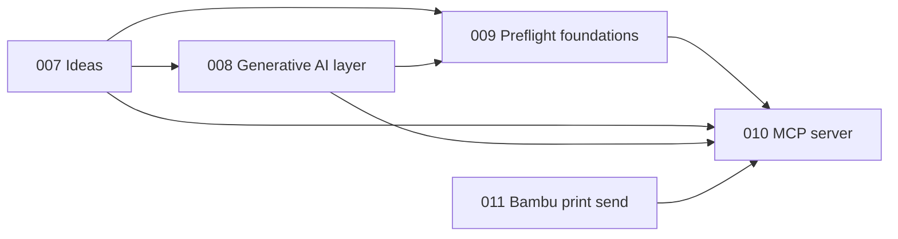

# Architecture: Ideas, Generative AI (Replicate) and Preflight foundations

Status: proposed (2026-11-23). Source of the Preflight requirements:
`modeling/fixing/reports/Architecture outil préflight.md` in the modelling workspace.

This document fixes the shape of five features so they fit Batchivo's existing
patterns and can be specified one by one with Spec Kit. Each feature has a
backlog entry in `specs/backlog.md` (007 to 011) that is the prompt for
`/speckit-specify`.

## 1. Goals and constraints

- **Ideas**: a place to capture, brainstorm and iterate on product ideas (text,
  images, links, sketches, generated concepts, decisions), then turn an idea
  into a Model or a Product without retyping.
- **Generative AI through Replicate**: one provider-agnostic layer that any
  screen or agent can call for a *capability* (concept image, image edit,
  product photo enhancement, background removal, upscaling, lifestyle scene,
  image to 3D), with Replicate as the first provider.
- **Preflight foundations (phase 0)**: the data Preflight needs (design brief,
  typed notes, calibrations, test results), an MCP server so agents can read
  and write Batchivo, and sending a print to a Bambu printer.

Constraints taken from the constitution and the codebase:

| Constraint | Consequence here |
|---|---|
| I. Every table has `tenant_id`; endpoints use `CurrentTenant` + `TenantDB` | All new tables are tenant-scoped with RLS policies in their migration |
| II. Tests ship with the change | Each spec lists the endpoint/service/schema tests the testing policy requires |
| III. One implementation per calculation | Generation cost accounting lives in one service; no cost figure is recomputed in routes or the frontend |
| IV. Money is exact | Generation cost and budget are `Decimal` / `Numeric`, strings on the wire |
| VI. History immutable, provenance visible | A generation job keeps the exact model version, inputs and seed; a calibration is superseded, never edited |
| Module gating is frontend-only today (`ModuleGuard`) | New modules are added to `ALL_MODULES`, `DEFAULT_MODULES_BY_TYPE`, `MODULE_NAVIGATION`, `MODULE_ORDER`; API routes are not gated, as for existing modules |
| `ImageStorage` is product-keyed | Generalised once (feature 007) so ideas and generations reuse it |
| Celery + Redis already run long jobs; the frontend polls with `refetchInterval` | Generation jobs use the same pattern as `mesh_measure` and scenario runs |

## 2. Feature map and order



| # | Feature | Depends on | Why this order |
|---|---|---|---|
| 007 | Ideas module | — | Useful on its own; introduces the generic owner-keyed image storage that 008 reuses |
| 008 | Generative AI layer (Replicate) | 007 (storage, first consumer) | Ideas is the first screen to call it; Products and Models follow in the same spec |
| 009 | Preflight foundations | 007, 008 | A design brief can start on an idea, before a model exists |
| 010 | Batchivo MCP server | 007, 008, 009 (tools grow with each) | Exposes what exists; can ship early with read-only tools and grow |
| 011 | Bambu print send | — | Independent; touches only the printer integration |

010 can start right after 007 with read-only tools; its tool list grows as 008, 009 and 011 land.

## 3. Shared foundation: owner-keyed media storage (in 007)

Today `ImageStorage.save_image(file_content, content_type, product_id, ...)`
writes to `products/{product_id}/` and `main.py` serves `/uploads/products/...`.

Change (backward compatible):

- `ImageStorage.save_image(..., owner_type: str, owner_id: UUID)` with
  `owner_type ∈ {"products", "ideas", "generations"}`; the product call sites
  pass `owner_type="products"`, so existing paths and URLs do not move.
- The uploads route serves `/uploads/{owner_type}/{owner_id}/{filename}` for the
  allowed owner types only, with the same path-traversal checks.
- Same local/S3 split, same 10 MB limit and thumbnails. Meshes from image-to-3D
  go through `ModelFileService` (500 MB, measurement queue), not `ImageStorage`.

## 4. Feature 007: Ideas

### Data model

```
Idea
  id, tenant_id
  title, summary (markdown)            -- the problem and the idea in a few lines
  status: inbox | exploring | validating | ready | converted | parked | dropped
  source: manual | pain_point_scout | customer | other ; source_url
  tags (JSONB string list)
  scores (JSONB): frequency, frustration, printability, gap, willingness_to_pay (1-5 each,
                  same grid as the pain-point-scout skill; total computed on read)
  cover_entry_id (nullable, FK IdeaEntry)  -- image shown on the board
  converted_model_id, converted_product_id (nullable FKs)
  created_by_user_id, created_at, updated_at, archived_at

IdeaEntry                               -- the brainstorming timeline, newest first
  id, tenant_id, idea_id
  kind: note | image | link | sketch | generation | measurement | decision | brief
  iteration (int, default = idea's current iteration)
  body (markdown, nullable)
  image_url, thumbnail_url, content_type, original_filename, file_size (nullable)
  link_url (nullable)
  generation_job_id (nullable, FK GenerationJob, added by 008)
  pinned (bool), author_user_id, created_at, archived_at
```

One polymorphic timeline table keeps the screen and the API simple and lets new
entry kinds appear without new tables. `iteration` groups entries ("iteration 3:
switched to a clip-on design") without a separate table.

Traceability back from what an idea became: nullable `source_idea_id` on `Model`
and `Product`.

### API (`/api/v1/ideas`, `api/v1/ideas.py` + `services/idea_service.py` + `schemas/idea.py`)

| Method | Path | Purpose |
|---|---|---|
| GET | `/ideas` | List with filters (status, tag, search, source), sort (updated, score), pagination |
| POST | `/ideas` | Create |
| GET/PATCH/DELETE | `/ideas/{id}` | Read, update (status, scores, tags…), archive |
| GET/POST | `/ideas/{id}/entries` | Timeline; create a note/link/decision |
| POST | `/ideas/{id}/entries/images` | Upload one or more images (multipart) |
| PATCH/DELETE | `/ideas/{id}/entries/{entry_id}` | Edit, pin, archive |
| POST | `/ideas/{id}/iterations` | Start the next iteration (optional note) |
| POST | `/ideas/{id}/convert` | `{target: "model" \| "product", name?, include_images?}` → creates the Model, or the Product (+ its Model and BOM line), copies the cover/pinned images, sets `converted_*` and `status=converted`, returns the new ids |
| POST | `/ideas/import` | Bulk create from a pain-point-scout report (title, summary, scores, source_url) |

Conversion uses the existing product creation service (`models: [{model_id, quantity}]`) rather than writing `ProductModel` rows itself (principle III).

### Frontend

- Route `/ideas` (board) and `/ideas/$ideaId` (detail), under `ModuleGuard`; icon `Lightbulb` in `ICON_COMPONENTS`; module `ideas` in navigation.
- **Board**: columns by status (inbox → ready), cards with cover image, score and tags; a list view with search and filters for scale (paginated, never loads all ideas).
- **Detail**: header (title, status, scores, tags, Convert button), timeline grouped by iteration, image gallery, composer (note, image upload with drag-and-drop and paste, link), and — once 008 lands — "Generate" actions.
- Files: `lib/api/ideas.ts`, `hooks/useIdeas.ts`, `components/ideas/*`, `pages/Ideas.tsx`, `pages/IdeaDetailPage.tsx`; router mock updated (`router-mock-covers-the-app` test).

## 5. Feature 008: Generative AI layer, Replicate first

### Shape

```
backend/app/services/genai/
  capabilities.py   -- Capability enum + input/output schema per capability
  catalog.py        -- capability → (provider, model slug, pinned version, input mapping,
                       default params); code defaults, overridable per tenant in settings
  base.py           -- GenAIProvider protocol: submit(), get(), cancel(), parse_webhook()
  replicate.py      -- Replicate adapter (HTTP API via httpx; webhook signature check)
  service.py        -- GenAIService: validate, check budget, create job, enqueue,
                       store outputs, account cost  (the one place cost is computed)
backend/app/tasks/genai.py   -- Celery: run_generation_job (submit + poll), with retry
backend/app/api/v1/genai.py  -- jobs, capabilities, webhook
```

Capabilities, not model names, are what callers ask for. Swapping a Replicate
model (or adding another provider later) changes the catalog, not the screens.

| Capability | Input | Output | Used from |
|---|---|---|---|
| `concept_image` | prompt, optional reference images, style, count | images | Ideas (concept from the idea text), Preflight intent |
| `image_edit` | image + instruction | image | Ideas (sketch → render, variations), Products |
| `product_photo_enhance` | product photo | image (relit, cleaned) | Products image editor |
| `background_remove` | image | PNG with alpha | Products, Ideas |
| `upscale` | image, factor | image | Products, Ideas |
| `lifestyle_scene` | product photo + scene prompt | image | Products (sales images), shop |
| `image_to_3d` | image(s) | GLB/mesh | Ideas (rough volume), Models (new version, flagged "generated draft") |

Text capabilities (alt text, SEO description, RMA categorisation from
`notes/feature-ideas.md` §3) fit the same job model later; they are out of scope
for 008.

### Data model

```
GenerationJob
  id, tenant_id, capability, provider, model_ref (slug + pinned version)
  inputs (JSONB: prompt, params, seed, input asset URLs)
  target_type: idea | product | model | none ; target_id
  status: queued | running | succeeded | failed | canceled
  external_id, error, started_at, completed_at
  cost (Numeric, provider-reported or computed by GenAIService), cost_provenance
  requested_by_user_id, created_at

GeneratedAsset
  id, tenant_id, job_id, kind: image | mesh
  url, thumbnail_url, content_type, file_size, width, height
  ai_generated = true (always), adopted_as (nullable: product_image_id | idea_entry_id | model_file_id)
```

A job's inputs, model version and seed are written once (principle VI), so any
image can be traced to how it was made. Adopting an output (as a product image,
an idea entry or a model file) copies it to that owner and records `adopted_as`.

### Execution

1. `POST /genai/jobs {capability, inputs, target}` → `GenAIService` validates the
   inputs against the capability schema, checks the tenant budget, creates the job
   (`queued`), enqueues `run_generation_job`.
2. The Celery task submits to Replicate and polls with backoff. If the instance is
   publicly reachable, a webhook (`POST /genai/webhooks/replicate`, signature
   verified with the webhook secret) completes the job sooner; polling remains the
   fallback, so local development works without a public URL.
3. **Outputs are downloaded immediately** into Batchivo storage: Replicate deletes
   API prediction inputs and outputs after one hour.
4. The frontend polls `GET /genai/jobs/{id}` with `refetchInterval` while the job is
   `queued`/`running`, as for mesh measurement.

### Credentials, budget, safety

- Token resolution: tenant key in `Tenant.settings["replicate"]["api_token_encrypted"]`
  (Fernet, `core/encryption.py`, Square/Etsy pattern, masked in responses), else the
  platform key `REPLICATE_API_TOKEN` from config. Settings page: key, test
  connection, monthly budget, per-capability model overrides.
- Budget: a monthly cap per tenant (`Decimal`); a job that would exceed it is
  refused before submission; usage per month is shown on the settings page.
- Sales images: every image records its origin (`photo`, `render` of the real
  geometry, e.g. from Blender, or `ai`), and AI-generated or AI-edited images show a
  badge. A product listing must show the real item; the product image editor warns
  when an image that is neither a photo of the product nor a render of its real
  geometry (a `concept_image` or an `image_to_3d` output) is set as a product image. Marketplace disclosure rules for AI images are
  to be checked per channel before export.
- Rate limit: max concurrent jobs per tenant (config), to protect cost and the worker.

### Frontend

- `lib/api/genai.ts`, `hooks/useGenerationJob.ts`.
- A reusable `<GenerateImageDialog capability target>` (prompt, references, count,
  estimated cost, result grid with "Adopt") used by Ideas, the product image editor
  and the model page.
- Settings → Integrations → Replicate.

## 6. Feature 009: Preflight foundations

| Entity / change | Fields | Notes |
|---|---|---|
| `DesignBrief` | `idea_id` (nullable), `model_id` (nullable, at least one), `intent` (JSONB, versioned schema), `risk_md`, `plan_md`, `params` (JSONB), `step_status` (JSONB: intent/clarify/risk/plan/check/slice/test/ship) | Starts on an idea, follows it to the model on conversion |
| `ModelFileNote` (extend) | `source` (human \| preflight \| print), `rule_id`, `severity` (info \| warn \| fail), `measured_value` | All nullable / defaulted: manual notes keep working unchanged |
| `Calibration` | `printer_id`, `filament_type_id` or `material_id`, `orientation`, `fit_type`, `value_mm` (Numeric), `provenance` (measured \| assumed), `source_print_job_id`, `measured_at`, `superseded_by_id` | Superseded, never edited (principle VI) |
| `PrintTestResult` | `print_job_id`, `model_file_version_id`, `outcome` (pass \| fail \| partial), `measurements` (JSONB), `failure_mode`, `photo_url`, `notes` | Feeds `/pf.learn` |
| `PrinterConnection.access_code`, `cloud_token` | encrypt with `core/encryption.py` + data migration | Currently plaintext ("consider encryption" comment); needed before 011 |

## 7. Feature 010: Batchivo MCP server

- **Process**: a separate entry point `backend/app/mcp_server/` built on the official
  MCP Python SDK; stdio transport for Claude Code locally first, streamable HTTP later.
- **Calls the REST API, not the database.** Tenant scoping, RLS, validation and
  services are reused as they are; the MCP layer stays thin and cannot bypass
  principle I.
- **Auth**: a personal API token (new `ApiToken`: user, tenant, hashed token, scopes,
  expiry, last_used) accepted by the auth dependency as an alternative to the JWT.
  Scopes: `read`, `write`, `genai`, `print`.
- **Tools** (grow with each feature): ideas (list, get, create, add entry, upload
  image, convert, import report); models, versions, notes (list, add typed note,
  resolve/carry); printers, spools, AMS slots; print jobs and production runs (read);
  genai (list capabilities, start job, get job, adopt output); design briefs and
  calibrations (009); print send (011, `print` scope, confirmation required).
- Configured for the modelling workspace through `.mcp.json`.

## 8. Feature 011: Bambu print send

- Extend `bambu_mqtt.py`: FTPS upload of a `.gcode.3mf` to the printer, then the
  `project_file` print command (LAN + Developer Mode). Reference implementations:
  open-source Bambu MCP servers (GPL, read as reference only — Batchivo is MIT).
- Two-step API: `POST /printers/{id}/prints/prepare` (file, plate, AMS mapping) returns
  a summary and a short-lived confirmation token; `POST .../confirm` starts the print.
  Nothing starts without the confirm call, from the UI or from MCP.
- Creates/updates the `PrintJob`; status continues to flow through the existing MQTT
  status handling.
- Documents the trade-off: Developer Mode disables cloud access; without it, the
  operator sends through Bambu Connect or Bambu Studio.

## 9. Risks and open questions

| Topic | Risk | Decision / question |
|---|---|---|
| Module gating | API routes stay ungated, as today | Accepted for consistency; backend gating is a separate cross-cutting change |
| Replicate model churn | A pinned version disappears | Catalog override per tenant + a failing-capability alert; versions pinned, not "latest" |
| Cost | Runaway generation | Budget cap checked before submission, concurrency limit |
| Generated sales images | Misrepresenting the product | `ai_generated` flag, badge, warning on adoption; channel rules checked before export |
| Webhooks on local dev | No public URL | Polling is the primary path; webhook is an accelerator |
| MCP auth | Token leakage | Hashed tokens, scopes, expiry, revocation, last-used shown |
| Bambu Developer Mode | Firmware may restrict it; cloud lost | Send is optional; slicing output stays usable without it |
